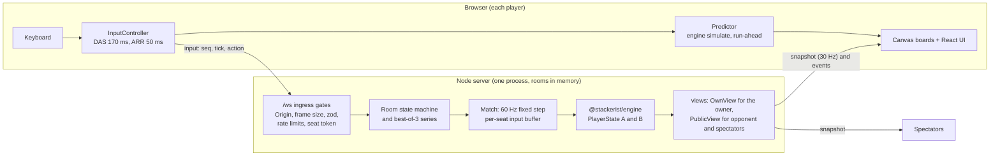

# Stackerist

## Pitch

Stackerist is a head-to-head online falling-block game for two players, with spectators. Each player has a 10 by 20 board and the same sequence of pieces. Clearing lines sends garbage rows to the other board. Clearing lines on consecutive pieces builds a combo that hits harder, and every attack first cancels any garbage that is already on its way to you. A match is a best-of-3 series, and the falling speed rises every 30 seconds, so rounds end. The server is the only authority: browsers send key presses, never game state, and the rules engine that runs on the server is the same pure code the browser uses to make your own board feel instant. There are no accounts and no database. It is built so a parent can share a link with a child and her friends, and nothing about the players survives once a room closes.

## How to run

You need Node 24 (`.node-version` is `24`; `engines` in `package.json` is `>=24 <25`) and pnpm 11 (`packageManager` is `pnpm@11.22.0`; `corepack enable` provides it).

```sh
pnpm install
pnpm build
pnpm start
```

Then open <http://localhost:3000>. `pnpm start` runs one Node process that serves the built client, the WebSocket at `/ws` and `GET /healthz` on a single port. The port is `PORT` and defaults to 3000.

| Command          | What it does                                                                                                                                                           |
| ---------------- | ---------------------------------------------------------------------------------------------------------------------------------------------------------------------- |
| `pnpm install`   | Installs all workspaces. CI uses `pnpm install --frozen-lockfile`.                                                                                                     |
| `pnpm build`     | `tsc -b tsconfig.build.json` for the engine, protocol and server, then the Vite build of the client.                                                                   |
| `pnpm start`     | `node apps/server/dist/index.js`. Needs `pnpm build` first.                                                                                                            |
| `pnpm dev`       | Server (tsx watch, port 3000) and Vite client (port 5173) together. Open <http://localhost:5173>; Vite proxies `/ws` and `/healthz`.                                   |
| `pnpm test`      | Vitest across the `engine`, `protocol`, `server`, `client` and `tools` projects.                                                                                       |
| `pnpm typecheck` | `tsc -b` over every project reference. It also emits the packages' `dist` folders.                                                                                     |
| `pnpm lint`      | `eslint . --max-warnings=0` then `prettier --check .`. `pnpm format` fixes formatting.                                                                                 |
| `pnpm e2e`       | Builds, then runs the Playwright suite in a real Chromium against the production build. If Chromium is not installed yet, run `pnpm exec playwright install chromium`. |

`pnpm test:coverage` runs the engine tests with V8 coverage and fails below 90 % lines.

On a fresh clone, run `pnpm typecheck` (or `pnpm build`) once before `pnpm test`. When this README was written, the client tests failed to resolve `@stackerist/engine` and `@stackerist/protocol` until the packages' `dist` folders existed (17 client test files on a clean checkout). CI already runs `pnpm typecheck` before `pnpm test`.

Other environment variables: `HOST` (default `0.0.0.0`), `LOG_LEVEL` (default `info`), `CLIENT_IP_SOURCE` and `TRUSTED_PROXY_HOPS` (see [Deploying](#deploying)). On Windows PowerShell set a variable with `$env:PORT = 8080; pnpm start`.

## How to play

1. Open the home page, type a name (1 to 16 characters) and press **Create game**.
2. Share the 6-character room code or the invite link (`/g/<CODE>`) from the lobby. Codes use the letters and digits `ABCDEFGHJKMNPQRSTUVWXYZ23456789` (no `0`, `O`, `1`, `I` or `L`) and are not case-sensitive.
3. Your friend opens the link, or types the code on the home page, enters a name and joins. When both players are in, a 3-second standoff counts `3 2 1`, then **DUEL!**. Keys go live at the moment DUEL! appears.

You need a keyboard. On a phone or tablet the game says so and offers **Watch instead**. Watching works on a phone but is small (see [Known limitations](#known-limitations)).

### Controls

| Key                     | Action                                                                         |
| ----------------------- | ------------------------------------------------------------------------------ |
| Left / Right arrows     | Move. Hold to repeat: first repeat after 170 ms (DAS), then every 50 ms (ARR). |
| Up arrow or `X`         | Rotate clockwise                                                               |
| `Z` (`Ctrl` also works) | Rotate back (counter-clockwise)                                                |
| Down arrow              | Soft drop while held                                                           |
| Space                   | Hard drop (lands and locks at once)                                            |
| `M`                     | Music on or off (remembered in this browser; on by default)                    |

### Rules that matter

- **Speed.** The level rises every 30 seconds, from 0 to 12. At level 0 a piece falls one row per second; at level 12 it falls one row every tick (60 per second), which is reached after 6 minutes. Soft drop is one row per 2 ticks. A piece that rests on something locks after half a second (30 ticks), and up to 15 moves or rotations can restart that timer.
- **Attacks.** Clearing 1 line sends 0 rows, 2 lines send 1, 3 lines send 2, 4 lines send 4.
- **Combos.** Each consecutive piece that clears at least one line raises your combo by one. A combo adds a bonus to the attack: combo 1 is +0, 2 and 3 are +1, 4 and 5 are +2, 6 and 7 are +3, and 8 or more is +4. A chain of single-line clears therefore sends 0, 1, 1, 2, 2, 3, 3, 4, 4. A piece that clears nothing resets the combo to 0.
- **Cancelling.** Your attack first pays down garbage that is already heading to you, oldest first. Only what is left over is sent to your opponent.
- **Garbage rows** have exactly one empty cell. All rows of one attack share the same hole column; separate attacks get independent random columns chosen by the server.
- **Garbage waits behind a combo.** Incoming garbage is not inserted on a piece that clears a line. It lands on the first piece that clears nothing, so it queues up behind a live chain and arrives when the chain breaks.
- **Losing.** You lose when a new piece cannot enter the board, or when garbage pushes a block above the top. If both players lose in the same tick, the round is a draw and is replayed.

### What you see

- Your own board is large, with a **ghost** outline showing where the piece will land (own board only) and the **next 5 pieces**. The opponent's board is smaller and shows their **next 1 piece**.
- A meter beside each board shows how many garbage rows are pending. An amber projectile flies across when an attack is sent, and cancelled rows burst out of the defender's meter. These are visual only.
- The **danger pulse**: a board's frame pulses red while its stack height plus pending garbage is 16 rows or more (of 20). With reduced motion turned on, the frame stays steady red.
- After each round, a result card shows both players' stats (pieces per second, actions per minute, lines, garbage sent, received and cancelled, best combo), a line chart of both stack heights over time, and your own best combo moment as a frozen picture of the board.

### Best of 3

The first player to win 2 rounds takes the series. A drawn round counts for nobody and is replayed with the same round number. Between rounds both players press **Next round**; after the series ends, both press **New series** to start again at 0 to 0.

### Leaving, disconnecting and reconnecting

- **Leave** (with a confirm) forfeits the whole series; the opponent sees that you left.
- **Refreshing the page** puts you back in your seat. Your seat token is kept in the tab's `sessionStorage`, so this works in the same tab only.
- **If your connection drops mid-round**, the round pauses for both players and your opponent sees a countdown. You have 20 seconds to come back; both players then get a 3-second countdown and play continues from the exact paused state. Each player may cause at most 3 pauses per series. A fourth drop, or running out the 20 seconds, forfeits the series.
- **If you drop between rounds**, your seat is held for 2 minutes. After that the series goes to your opponent.
- A room is deleted when nobody has been connected for 2 minutes, or when it was created more than 15 minutes ago and no round ever started.

### Spectators

Open the invite link with `?watch=1`, or join a room whose two seats are taken, and you watch both boards read-only with names and the series score. Players see how many are watching. A room holds up to 8 spectators; the ninth gets the "room is full" message.

## Architecture



| Package             | Role                                                                                               |
| ------------------- | -------------------------------------------------------------------------------------------------- |
| `packages/engine`   | Pure rules: board, pieces, SRS kicks, 7-bag, gravity, locking, combos, garbage. No I/O.            |
| `packages/protocol` | zod schemas for every message, constants, the information-hiding views, tick estimator, Predictor. |
| `apps/server`       | Fastify and `@fastify/websocket`: rooms, series, match loop, anti-cheat, static files, `/healthz`. |
| `apps/client`       | Vite, React and `<canvas>`: screens, keyboard input, prediction, rendering, synthesized music.     |
| `e2e`, `tools`      | Playwright tests, and repository checks (Dockerfile, `railway.json`, CI, this README).             |

How it fits together:

- **The server is the only source of truth.** The protocol has no message that carries a board, a line clear or garbage. A client sends `input { seq, tick, action }`; the server applies it to the seat's own state and sends snapshots back. Server snapshots always win.
- **One pure engine, shared.** `packages/engine` has no `Date`, no `Math.random`, no I/O and no floating-point game state. ESLint bans those globals there, its `tsconfig` has `types: []` so Node and DOM APIs do not type-check, and a purity test deep-freezes every input. The server runs it as the authority; the client runs the same code to predict.
- **The protocol is the contract.** Every message is a strict zod schema (unknown keys are rejected), and every constant that both sides use (paths, limits, error and close codes) is defined once in `packages/protocol/src/constants.ts`. `views.ts` is the information-hiding boundary: the owner of a board gets the piece queue (5 pieces) and exact pending garbage; the opponent and spectators get 1 upcoming piece and a pending total.
- **Server loop.** A 60 Hz fixed-step loop with an accumulator catches up at most 5 ticks per wake, so a stall cannot spiral. Snapshots go out at most every 2 ticks (30 Hz), and immediately after any piece locks. Piece and garbage-hole seeds are drawn on the server and never sent.
- **Run-ahead prediction with tick-stamped inputs, and no rewind.** At level 12 a piece falls a row every 16.7 ms, so a plain "send, wait, show" client would land moves rows too low at 40 to 60 ms of round-trip time (the design's builder check estimated 3 to 5 rows). Instead the client estimates the server's current tick from the countdown message and the measured round trip, shows its own board at the tick its input will arrive (`estimated server tick + ceil((rtt / 2) / 16.67 ms) + 1`), and stamps each input with that tick. The server keeps each seat's inputs in a buffer and applies those stamped at or before the current tick. A stamp in the past is applied on arrival, because the server never rewinds. A stamp more than 30 ticks ahead, or earlier than the seat's previous stamp, is rejected with `BAD_TICK`. A stamp can only delay your own input, never move it earlier. When a snapshot arrives, the client drops acknowledged inputs, re-simulates from the snapshot to the target tick and snaps to the result. Incoming garbage is never predicted; it shows up from the server's snapshots.

For the full design see [docs/architecture.md](docs/architecture.md) and the approved [design document](docs/superpowers/specs/2026-11-07-stackerist-design.md). The original specification is `spec (1).md` in the repository root; where the design document disagrees with it, the design document wins.

## How we prevent cheating

The rule is: assume players will cheat. The first table is the source specification's anti-cheat table (section 4.5), one row per threat, with the defence in the code and the test that proves it. The tests are in `apps/server/test`, `packages/protocol/test` and `apps/client/test`.

| Threat                                                  | Defence                                                                                                                                                                                                    | Proved by                                                                                                                                              |
| ------------------------------------------------------- | ---------------------------------------------------------------------------------------------------------------------------------------------------------------------------------------------------------- | ------------------------------------------------------------------------------------------------------------------------------------------------------ |
| Fake board, fake line clears or fake garbage            | No protocol message carries game state. Unknown message types and unknown keys are `BAD_MESSAGE`. The server computes everything.                                                                          | `anticheat.test.ts`: "a client message carrying game state is not a message"                                                                           |
| Choosing or peeking at future pieces                    | The seed is server-only. The owner sees 5 upcoming pieces, the opponent and spectators 1. No message contains a seed, bag or queue key. (See the seed limitation below.)                                   | `hiding.test.ts` (spec 8.2 case 14), run on every message through the strict server schema                                                             |
| Speed hack or slowing gravity                           | Gravity and lock delay run only inside the server's tick. A client's tick stamp can delay its own input but never moves it into the past.                                                                  | `anticheat.test.ts`: "gravity and lock delay run on the server", "a stamp in the past applies at the current tick"                                     |
| Input flooding or inhuman macros                        | Token bucket per seat: burst 20, refill 30 a second, charged once when the input arrives. Over-limit inputs are dropped silently and counted. 200 drops in a series closes the socket with `RATE_LIMITED`. | `anticheat.test.ts`: spec 8.2 case 11, "the bucket is charged once at receipt", "the 200-drop limit counts across the whole series"                    |
| Malformed or oversized messages                         | Frames over 1,024 bytes get `BAD_MESSAGE`; the WebSocket layer closes frames over 16 KiB before the app sees them; every message is zod-validated; 20 bad messages close the connection.                   | `anticheat.test.ts` (spec 8.2 case 12), `badframes.test.ts`                                                                                            |
| Acting as the other player, or seat hijacking           | The seat is bound to the socket after the token check, and actions apply only to that seat. Seat tokens are 128-bit random and are compared with `crypto.timingSafeEqual` on equal-length buffers.         | `lobby.test.ts`: "rejoin with a wrong token is rejected", "a socket acts only on its own seat". No test measures the timing of the compare.            |
| Replaying or reordering inputs                          | `seq` must strictly increase (`BAD_SEQ`). Tick stamps may not go backwards or more than 30 ticks ahead (`BAD_TICK`).                                                                                       | `anticheat.test.ts` (spec 8.2 case 10), "stamps more than 30 ticks ahead ... get BAD_TICK"                                                             |
| A spectator sends inputs                                | Ignored; the reply is `NOT_A_PLAYER`.                                                                                                                                                                      | `spectators.test.ts` (spec 8.2 case 13)                                                                                                                |
| Inputs before the start, after the game or while paused | Rejected with `NOT_PLAYING`.                                                                                                                                                                               | `anticheat.test.ts`: "inputs before the start, while paused and after game over are rejected"                                                          |
| Disconnecting to pause the opponent                     | At most 3 pauses per player per series, a 20-second grace, then forfeit.                                                                                                                                   | `disconnect.test.ts` (spec 8.2 cases 7 and 8)                                                                                                          |
| XSS through player names                                | Names are trimmed and must be 1 to 16 characters. Control, format and bidirectional-override characters are refused. Names render as text only, inside `<bdi>`, never as HTML.                             | `names.test.ts` (protocol); `apps/client/test/ui` scans the UI source for `innerHTML`, `outerHTML`, `insertAdjacentHTML` and `dangerouslySetInnerHTML` |

### Further hardening from the security review

A read-only security review of the server found two availability defects (an unbounded send buffer for a slow reader, and one IP address filling the room cap), both fixed. Semgrep (four public rulesets, 92 files) reported 0 findings, but a planted-bug control showed it misses some classes (it caught 2 of 4 planted bugs), so the review relied on reading the code as well. The fixes were re-attacked by the orchestrator with the reviewer's own scripts. A fresh independent re-review is not on record.

- **Origin check.** A browser WebSocket upgrade whose `Origin` host differs from the request's `Host` is refused with 403, so another website cannot drive a visitor's browser into your game. A request with no `Origin` header is allowed, so scripts and tests are not affected: this stops other sites, not scripted cheaters.
- **Headers on every response:** `Content-Security-Policy` (`default-src 'self'`, `script-src 'self'`, `style-src 'self'` in production, `frame-ancestors 'none'`, `base-uri 'none'`, `object-src 'none'`, `connect-src` limited to the site and its own `wss://` host), `X-Content-Type-Options: nosniff` and `Referrer-Policy: no-referrer`.
- **Per-IP limits.** 10 room creates a minute, 20 failed joins a minute (a rejoin with the correct token is not blocked by this), 6 rooms per creator (every room that has not been deleted counts, empty ones included, so creating and abandoning rooms cannot park them), 40 open sockets. IPv6 addresses count per `/64`, and each `/48` also has an aggregate cap of 24 rooms and 160 sockets. A socket over its limit is told `SERVER_BUSY` and closed with code 1013.
- **Global caps.** 500 live rooms, 2,000 open sockets. A finished room that nobody uses is deleted after 10 minutes, and no room lives longer than 3 hours (a round in progress is never cut off by age; the room closes once it is between rounds).
- **Per-connection flood limit.** Messages other than inputs (join, leave, rematch, pong) have their own bucket: burst 20, refill 5 a second.
- **Slow-reader cap.** A socket whose outgoing buffer passes 512 KB is closed with code 4005 (`SLOW_CONSUMER`) and can rejoin with its token. A `pong` only counts as liveness when it answers an outstanding `ping`.
- **Crash resistance.** Every message handler, timer and room step is wrapped so one bad request cannot take down every live match. Malformed URLs such as `/g/%` get an error page. Logs carry room codes and seat letters, never names, IP addresses or tokens.

### What is and is not covered

- Covered: forging state, hijacking a seat, replaying or reordering inputs, flooding, oversized or malformed frames, abusing pauses, name-based XSS, cross-site WebSocket use, and exhausting rooms, sockets or memory from one address.
- Not covered: a determined scripted client can recover its own piece seed (see [Known limitations](#known-limitations)). A bot that reads the screen and plays within the input limits cannot be told apart from a person, and neither can an assistive overlay.
- Verified on Railway on 2026-11-11: the per-IP limits rely on the platform overwriting `X-Real-IP`, and eight creates that each claimed a different address were counted as one client (see [Deploying](#deploying)).
- Most of the end-to-end suite runs with a relaxed `style-src` that allows inline styles, because its probes inject `<style>` tags. One dedicated spec runs a real match under the strict production policy (see [How the rules are tested](#how-the-rules-are-tested)).

## How the rules are tested

As of commit `f9ff770` on `build/v1`, `pnpm test` runs 90 test files and 1,164 tests, all passing (measured 2026-11-11). GitHub CI is green on the commit that records these numbers (see the ledger). Every test title that proves a requirement starts with its id (for example `REQ-014`), and the conformance check maps requirement ids to tests. The result for every requirement is in [docs/conformance.md](docs/conformance.md), and the pre-deploy review of operations (logs, configuration, dependencies, rollback) is in [docs/production-readiness.md](docs/production-readiness.md).

| Layer                     | What it proves                                                                                                                                                                                                                                                                                                                                                                                                                                 | Where                                   |
| ------------------------- | ---------------------------------------------------------------------------------------------------------------------------------------------------------------------------------------------------------------------------------------------------------------------------------------------------------------------------------------------------------------------------------------------------------------------------------------------- | --------------------------------------- |
| Engine unit tests         | Every rule, one file per area: board and parsing, piece spawn cells, movement and collision, SRS rotation and kicks, hard and soft drop, lock delay and resets, line clears, garbage, garbage held behind a combo, combo table, cancelling, best moment, 7-bag and seeds, config constants, purity, `simulate`.                                                                                                                                | `packages/engine/test`                  |
| The 31 required cases     | The 31 engine cases listed in section 8.1 of the source spec, each tagged `#1` to `#31` in its test title and grouped under `REQ-063`. Boards are written as readable fixtures with `parseBoard`.                                                                                                                                                                                                                                              | `packages/engine/test`                  |
| Property test             | With fast-check, 200 random runs of up to 400 steps (actions, ticks at levels 0 to 12, incoming garbage). After every step: the board is 20 by 10, the active piece is in bounds and overlaps nothing, no full row survives a lock, and inputs are never mutated.                                                                                                                                                                              | `packages/engine/test/property.test.ts` |
| Protocol tests            | Every schema round-trips; names, codes and bounds; the views never leak; the tick estimator; the Predictor.                                                                                                                                                                                                                                                                                                                                    | `packages/protocol/test`                |
| Server integration        | Real `ws` clients against a server on a random port. The clock is injectable (`ManualClock`), the loop can be stepped by hand, and seeds and the hole generator are injectable, so every test is deterministic. Every inbound message is checked against the strict server schema, so no-leak assertions run in every test. Covers the 14 cases in section 8.2 of the source spec plus series, report, limits, security and slow-reader cases. | `apps/server/test`                      |
| Latency harness (REQ-082) | See below.                                                                                                                                                                                                                                                                                                                                                                                                                                     | `apps/server/test/latency.test.ts`      |
| Client unit tests         | Input DAS and ARR, prediction wiring, canvas maths, effects, danger, music scheduling, screens and copy. They run in Node without a DOM, because the behaviour is proven in a real browser instead.                                                                                                                                                                                                                                            | `apps/client/test`                      |
| End-to-end (real browser) | Two Chromium contexts play real rounds against the production build. See below.                                                                                                                                                                                                                                                                                                                                                                | `e2e`                                   |
| Repository checks         | Dockerfile, `railway.json`, CI workflow, region id and this README, parsed from the real files.                                                                                                                                                                                                                                                                                                                                                | `tools/test`                            |

**Latency harness (REQ-082).** One virtual clock drives a real server. A link delays every frame by 75 ms each way (150 ms round trip) and the server runs at level 12, where a piece falls one row a tick. The predicting client in the test is the production `TickEstimator` and `Predictor`, not a copy. After every piece, the cells the player was shown must equal the cells the server locked, in the same tick. In the recorded run (ledger, 2026-11-09), 12 of 12 shown landings equalled the server's, and 14 of 14 locks matched in cells, tick and board. Garbage that reaches the server inside the prediction window is the only allowed exception. The harness has two negative controls that must fail, which shows it can fail: a client that does not run ahead matched only 5 of 11 comparable landings, and a client that runs ahead but stamps the server's current tick matched 0 of 13 locks. A second test (REQ-069) checks that each input's effect appears within two ticks and before any server acknowledgement at 0, 50 and 150 ms round trip, and that pieces land where shown at levels 0, 3, 6, 9 and 12.

**End-to-end suite.** `e2e/*.spec.ts` drives real browsers: create and join by link, play to a result, refresh and rejoin, wrong code, the full room and the eighth and ninth viewer, explicit leave, disconnect, pause and resume, a full best-of-3 with the Next round and New series handshakes, the standoff timing, the report and chart against the server's own numbers, ghost, projectile, danger (and reduced motion), the music button, spectators, and a line clear producing a best-moment panel. One grace-expiry test takes about 40 seconds and only runs with `E2E_SLOW=1`.

Status at commit `f9ff770`, from a run of `pnpm e2e` on 2026-11-11 on an otherwise idle machine: 67 tests, 66 passed, 0 failed, 0 flaky, 1 skipped (the `E2E_SLOW` test, which passed when run on its own earlier). On a heavily loaded machine one spec (`geometry-signature`, the DUEL! overlay check) failed once; it passed 39 of 39 runs (3 repeats of 13 tests) when the machine was idle, so it is sensitive to load. A separate spec starts its own server with `NODE_ENV=production` and plays a real match under the strict Content-Security-Policy, with no policy violations and no console errors; it fails when the server is not in production mode.

CI does not run the end-to-end suite, so it does not show these. Re-run `pnpm e2e` for the current state.

**Geometry gate.** The same suite measures the layout instead of looking at it. At 1280 by 600 (a small laptop) and 390 by 844 (a phone) it checks for page overflow (`scrollWidth - clientWidth`), clipped vertical overflow, overlapping siblings, off-screen overlays and result cards, and touch targets below the design's minimums (44 px on home, lobby and result; 32 px in the in-game HUD). Each run first checks the fixture is healthy (fonts loaded, canvases sized, no console errors) so it cannot pass on a blank page. It can fail: dedicated tests inject faults (a clipped container, an over-wide body, a card forced too tall or off-screen, a shrunken button, overlapping siblings) and require the probe to report each one, then restore the page and require zero findings.

**Coverage.** Engine coverage from `pnpm test:coverage` on this commit: lines 100 % (314 of 314), branches 98.57 % (208 of 211), functions 100 % (77 of 77), statements 99.72 % (362 of 363). CI fails the build below 90 % lines.

**Mutation testing** (Stryker 10, measured 2026-11-11). It was run on the engine, the protocol package and the server, where a rule that is wrong but still passes the tests would hurt most. The client is not mutation-tested.

| Target                                           | Score before | Score after | Mutants |
| ------------------------------------------------ | ------------ | ----------- | ------- |
| Engine (9 files)                                 | 92.48 %      | 97.03 %     | 950     |
| Protocol (6 files)                               | 90.66 %      | 96.27 %     | 514     |
| Server (7 files)                                 | 81.88 %      | 96.27 %     | 723     |
| Connection and room gates (selected line ranges) | 76.52 %      | 89.28 %     | 345     |

Each surviving mutant on a critical path was either killed with a new test (all named with their `REQ-` ids, in the `mutation-gaps` and `mutation-gates` test files) or shown to be equivalent or unreachable, with the reason recorded in the ledger. Limits of this measurement:

- The server and gates "after" scores are the full baseline merged with re-runs of only the lines that had survivors. The 45-minute full server run was not repeated.
- `connection.ts` and `rooms.ts` are too slow to mutate as whole files, so only their gate line ranges were mutated. Fifteen of the gates were also broken by hand (bucket charged twice, token check loosened, spectator allowed to send input, rematch gate removed, `SAFE_HOST` and origin checks weakened and so on), and the tests went red each time.
- Equivalent mutants include guards made unreachable by `noUncheckedIndexedAccess`, constant-time token comparison (a test cannot see timing) and pruning-only code.

To re-run (the configuration and the per-target Vitest variants are in `stryker.config.mjs` and `stryker/`):

```
STRYKER_TARGET=engine pnpm exec stryker run stryker.config.mjs     # or protocol, server, gates
pnpm exec stryker run stryker.config.mjs --mutate "path/to/file.ts:40-80"   # narrow to a line range
```

Give parallel runs their own sandbox with `--tempDirName .stryker-tmp/<name>`. A full server run takes about 45 minutes. Reports go to `reports/`, which is not committed.

**Performance (REQ-068).** One running match used 3.91 % of one CPU core, with the loop holding 60.0 ticks per second and the largest snapshot at 1,734 bytes (budget 2,048). It was measured on a busy development machine, and the test passes if any one of up to three 10-second windows is under 5 %. Re-measure on the host.

## Design decisions

[DECISIONS.md](DECISIONS.md) lists each decision with its reason, one line each. The ones that shape the product most:

- The server decides everything; clients send intents only.
- Run-ahead prediction with tick-stamped inputs and no rewind, chosen over plain reconciliation because of top-speed latency.
- Combos and garbage cancelling were added to the original spec; garbage waits behind a live combo.
- Best of 3, with a replayed draw, a series-ending forfeit, 3 pauses and 200 dropped inputs per series.
- Node 24 instead of the spec's Node 20, which is end-of-life.
- No accounts, no database, no stored player data.

## Deploying

**Deployed on 2026-11-11** to Railway (project `stackerist`, region Singapore) from commit `9271b12`. Railway built the image on the first attempt, which was the first real build of this `Dockerfile`. The results of the first-deploy checklist are below; two items are still open.

### The image

The `Dockerfile` is multi-stage on Node 24 Alpine (`node:24-alpine`): a base with pnpm (pinned by `packageManager` through corepack), a build stage with a frozen install and `pnpm build`, a production-dependencies stage, and a slim runtime with no pnpm and no dev dependencies that runs as the `node` user. The image sets `NODE_ENV=production`, `PORT=3000` and `HOST=0.0.0.0`, and starts `node apps/server/dist/index.js` directly so the platform's SIGTERM reaches the server. The client imports files from `design/tokens` and `design/assets`, so the Docker build context and the build stage keep exactly those two folders.

### Railway

`railway.json` builds from the `Dockerfile`, health-checks `GET /healthz` (timeout 120 s), restarts on failure (up to 10 times) and pins one replica in the region `asia-southeast1-eqsg3a`, which Railway's deployment-regions documentation lists as Southeast Asia (Singapore). Its watch patterns include the root config files, so a change to only `package.json`, the lockfile, the `Dockerfile` or `railway.json` still triggers a build. Railway provides `PORT`; the server reads it.

Checklist for the first deploy:

1. **Read deploy success from Railway's deployment status, never from the CLI's exit code.** On the development machine the CLI has reported success for failed deploys. _Done:_ the status went `BUILDING` then `SUCCESS` in about a minute and the container logged `server.listening`.
2. Confirm the region shown in the deployment status is Southeast Asia (Singapore). _Done:_ the deployment manifest shows `asia-southeast1-eqsg3a` with one replica, and responses come from the `sin1` edge.
3. Confirm `GET /healthz` returns `{"ok":true}` and that two browsers on different networks can play a full match over `wss://`. _Half done:_ `/healthz` answers, and two scripted players ran a 70 second match over `wss://` at 60.0 ticks per second with 1,122 inputs and no errors. **Still open: two people on different networks playing a full match (REQ-076).**
4. **Verify the client IP header.** In production the server takes the client IP from `X-Real-IP` (`CLIENT_IP_SOURCE` defaults to `x-real-ip` when `NODE_ENV=production`; other values are `socket`, or `x-forwarded-for` together with `TRUSTED_PROXY_HOPS`). Railway documents `X-Real-IP` but not whether a value sent by the client is overwritten. Test it from one machine: send 11 room creates inside a minute, each with a different made-up `X-Real-IP`. If the 11th succeeds, the header passes through and the per-IP limits can be bypassed; switch the source or fall back to the socket address. Do not log IP addresses while testing. _Done:_ eight creates, each with a different made-up `X-Real-IP`: six rooms were created and the seventh and every later one was refused with `CREATE_LIMIT` (the cap is six live rooms per client), so Railway overwrites the header and the limits cannot be bypassed this way. The `Host` header is also preserved (the policy's `connect-src` names the public host and the `Origin` check passes), and a foreign `Origin` gets 403. IPv6 could not be tested: the Railway domain has no IPv6 address.
5. Re-measure the CPU budget on the container's metrics (see [How the rules are tested](#how-the-rules-are-tested)). **Still open:** the CPU percentage was not measured, because shell access to the container and the metrics API were not available in the session that deployed. What was measured: during the 70 second match the server held 60.0 ticks per second and snapshots were at most 1,739 bytes. Read the service's CPU graph in the Railway dashboard while a match runs.

### Other hosts (Fly.io, Render and similar)

Not tried. Any host that runs a Node 24 container and supports WebSockets on the same origin as the page should work. You need:

- one instance only: rooms live in memory, so there is no horizontal scaling;
- `PORT` set to the port the platform routes to, and `NODE_ENV=production` (the image already sets it);
- the platform's health check pointed at `/healthz`;
- TLS at the edge, with the original `Host` header passed through (the CSP `connect-src` and the Origin check both use it);
- `CLIENT_IP_SOURCE` set to match how your platform reports the client address: `x-forwarded-for` with `TRUSTED_PROXY_HOPS` equal to the number of proxies you trust, or `socket` when the server sees clients directly. The default `x-real-ip` is only right if the platform sets that header itself.

To try the image locally, `docker build -t stackerist .` then `docker run -p 3000:3000 stackerist`. These commands have not been run, because Docker is not installed on the development machine.

## Known limitations

- **The piece seed is only 31 bits.** The per-round piece seed and garbage-hole seed are 31-bit integers feeding a small PRNG. A determined scripted client can recover its seed in about a minute (the reviewer measured 51.7 seconds after about 15 placements) and then see its **own** future pieces beyond the 5-piece preview, and the columns of the garbage holes it will receive. It reveals nothing about the opponent's board or inputs and cannot change server-authoritative state, so the effect is an information advantage, not forgery. The owner accepted this for now; the remedy is under Future work.
- **Browser bots and assistive overlays cannot be prevented.** Software that reads the screen and sends legal inputs looks like a person.
- **Joining your own room from two tabs is allowed.** It is useful for testing and gives no advantage, because each seat still plays by the server's rules.
- **Phones are not a supported player platform, and there is no phone layout for watching.** The game is keyboard-only. Touch-only devices are warned and offered **Watch instead**, but the spectator view is the desktop layout scaled down to about half size on a 390 px screen, and the result card to between about 39 % and 54 % of full size, so both are hard to read. The owner decided on 2026-11-11 not to build a portrait layout for this. The in-game top bar fits a 390 px screen (Music shows as an icon only), but the "joined as spectator" notice collapses to nothing at that width.
- **The Docker image has never been built with Docker on the development machine.** Railway built it successfully on the first deploy (2026-11-11), but no local Docker build was ever run.
- **Per-IP limits depend on the host overwriting `X-Real-IP`.** Verified on Railway on 2026-11-11; if the host or its proxy setup changes, repeat the check in the first-deploy checklist.
- **A long server stall can make inputs bounce for a few seconds.** The server catches up at most 5 ticks per wake and drops the rest. After a stall of roughly 600 ms or more, the client's clock estimate stays ahead of the server's tick until its oldest samples age out (about 4 s), and in that window the server refuses inputs (`BAD_TICK`) and the piece snaps back. Found in code review; not fixed because it is rare and the fix is in the clock estimator.
- **The CPU budget was measured on a busy machine.** 3.91 % of one core, passing if any of three 10-second windows is under 5 %. Re-measure on the host.
- **Names refuse emoji and look-alike tricks, but not homoglyphs or text symbols reliably.** Emoji presentations, joined sequences, flags, skin tones and keycaps are refused (the owner's decision of 2026-11-10, for readability), as are control, format and direction-changing characters, blank-looking fillers and long stacks of combining marks; names are normalized (NFKC) and need at least one letter or digit. Letters that merely look like others (a Cyrillic "О" in "YОU") are accepted. Whether text-style symbols such as a star, a heart or the copyright sign are accepted depends on the Unicode data of the Node build that runs the server, so do not rely on either.
- **No name filter.** Names are shown unfiltered to people who joined with the private room code.
- **No accounts and no persistence, by design.** Rooms live in memory in one process; a restart ends every match.

## Future work

- Accounts and matchmaking
- Persistence and a database
- Hold piece
- T-spin and back-to-back bonuses
- Mobile touch controls
- Horizontal scaling (rooms are in one process today)
- "Save best moment as an image"
- Sound effects beyond the music
- A 128-bit server-side piece seed, or a crypto-backed bag, to close the seed limitation
